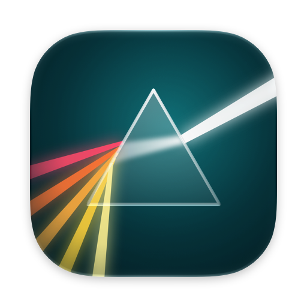

<a name="readme-top"></a>

<div align="center">
  
  <h1>Obelisk FX</h1>
  <p>
    VRChat focused community fork of <a href="https://github.com/Zagrios/Obelisk"><b>Zagrios/Obelisk</b></a> by <a href="https://github.com/SpecialOperations">@SpecialOperations</a>.<br>
    Adds per-game <b>MetalFX Spatial</b> upscaling, <b>2× MetalFX Frame Generation</b>, <b>Mic Voice Isolation</b>, native clipboard sync, and in-game video/media playback fixes for the Linux engine.
  </p>
  <p>
    <a href="https://github.com/SpecialOperations/Obelisk/releases/latest"><b>Download Obelisk FX</b></a>
    ·
    <a href="https://github.com/SpecialOperations/voile-lkd/releases/latest"><b>MetalFX Window Server (voile-lkd)</b></a>
    ·
    <a href="https://github.com/SpecialOperations/Obelisk/issues"><b>Report an Issue</b></a>
    ·
    <a href="https://github.com/Zagrios/Obelisk">Upstream Obelisk</a>
  </p>
  <p>
    <a href="https://github.com/SpecialOperations/Obelisk/releases/latest"></a>
    
    
    <a href="LICENSE"></a>
  </p>
</div>

> **Fork notice:** **Obelisk FX** is an independent community fork of [Zagrios/Obelisk](https://github.com/Zagrios/Obelisk) (all credit for Obelisk and Voile goes to Zagrios). Please report any bugs, crashes, or questions about Obelisk FX on **[SpecialOperations/Obelisk/issues](https://github.com/SpecialOperations/Obelisk/issues)** rather than to the upstream maintainer or upstream Discord.

<p align="center">
  <a href="https://github.com/SpecialOperations/Obelisk"></a>
</p>

## Obelisk FX Features & Improvements

- **MetalFX Spatial Upscaling** (Linux engine): Toggle right under **Render resolution** in a game's **Launch Settings**. Render at 50%–75% resolution for higher FPS and upscale sharply to native Retina pixels with Apple MetalFX.
- **2× MetalFX Frame Generation** (Linux engine, macOS 26+): Toggle right under **MetalFX Spatial**. Inserts interpolated midpoint frames for smoother motion on high-refresh displays and chains directly into MetalFX Spatial when both are enabled.
- **Mic Voice Isolation & Echo Cancellation** (Linux engine): Toggle under **Audio** in a game's **Launch Settings** (off by default; recommended when using your device's speakers and built-in mic). Routes game playback and microphone capture through macOS's native `VoiceProcessingIO` unit to cancel speaker echo and suppress background noise (also unlocks macOS Control Center's **Voice Isolation** mic mode).
- **Native Bidirectional Clipboard Sync** (Linux engine): Seamlessly copy and paste between macOS and Windows games (including in-game paste buttons and `Cmd+C/V/X/A`) via native clipboard synchronization between `wsd` and `wineobelisk.drv`.
- **In-Game Video & Media Playback** (Linux engine): Full Proton-GE FFmpeg-backed Media Foundation playback (`winedmo` / `mfmediaengine`) and same-process D3D11 shared texture support in Neptune so in-world/in-game video players (such as VRChat video players) play video and audio reliably.
- **Linux-engine stability & polish** (via the companion [SpecialOperations/voile-lkd](https://github.com/SpecialOperations/voile-lkd), [SpecialOperations/neptune](https://github.com/SpecialOperations/neptune), and [SpecialOperations/voile-wine](https://github.com/SpecialOperations/voile-wine) forks):
  - Higher GPU resource upload limit (512 MiB) so large worlds and assets load reliably without device-removed crashes.
  - Fixes for intermittent emulation crashes and deadlocks during heavy scene loads, garbage-collection thread suspension, and rapid ptrace attach/detach churn.
  - Improved Dock icon handling so background helper tools don't overwrite the running game's icon.

## Contents

- [What is Obelisk?](#what-is-obelisk)
- [Requirements](#requirements)
- [Installation](#installation)
- [Getting started](#getting-started)
- [Features](#features)
- [Store support](#store-support)
- [Windows games](#windows-games)
- [Performance](#performance)
- [How games run](#how-games-run)
- [Privacy](#privacy)
- [Known limitations](#known-limitations)
- [FAQ](#faq)
- [Support](#support)
- [Credits](#credits)
- [Contributing](#contributing)
- [License](#license)

## What is Obelisk?

Obelisk is a free game launcher for Macs with Apple silicon. Sign in with your Steam, Epic Games and GOG accounts, and every game you own shows up in one library, ready to download and play.

Windows games play too. Obelisk sets everything up for you: no bottles to create, no Wine to configure, no launcher to install. Click **Download**, then **Play**.

- **One library.** Every store in one place, with search across all of them, your recently played games and what is installed on this Mac.
- **No other launcher needed.** Steam, the Epic Games Launcher and GOG Galaxy do not need to be installed. Obelisk downloads, updates and launches games itself.
- **Windows games without setup.** Windows versions run through [Voile](https://github.com/Zagrios/voile), Obelisk's Windows runtime, which Obelisk installs and keeps up to date on its own.
- **Know how a game runs before you play.** A game's page shows the frame rate other players measured on a Mac with your chip.
- **Your saves follow you.** Steam and Epic Cloud saves sync before you play and after you quit.
- **Your friends are here.** See who is online and what they play, chat with Steam friends, and invite them or join their games.
- **Made for the Mac.** A native macOS app, made with SwiftUI.

## Requirements

- A Mac with Apple silicon (M1 or later). Intel Macs are not supported.
- macOS Tahoe 26.4 or later.
- Rosetta, for Windows games. If it is missing, Obelisk asks macOS to install it the first time a game needs it.
- Disk space for your games. The first Windows game also downloads [Voile](https://github.com/Zagrios/voile), a few hundred MB, once.

## Installation (Obelisk FX)

1. Download the latest Obelisk FX `.dmg` from the [latest fork release](https://github.com/SpecialOperations/Obelisk/releases/latest).
2. Open the disk image and drag **Obelisk FX** (`Obelisk.app`) onto **Applications**.
3. Because this community fork build is ad-hoc signed (not notarized by Apple), remove macOS's quarantine flag once before opening:
   ```sh
   xattr -dr com.apple.quarantine /Applications/Obelisk.app
   ```
4. Launch Obelisk FX and start any Windows game once if you don't already have Voile installed, then install the companion MetalFX `wsd` window server from [SpecialOperations/voile-lkd](https://github.com/SpecialOperations/voile-lkd/releases/latest) (one command):
   ```sh
   curl -fsSL https://github.com/SpecialOperations/voile-lkd/releases/latest/download/install-metalfx-wsd.sh | bash
   ```
5. In any Linux-engine game's **Launch Settings**, lower **Render resolution** (e.g. **50%**) and toggle **MetalFX Spatial**, **MetalFX Frame Generation**, and/or **Mic Voice Isolation** on.

> **Note:** Obelisk FX shares the `com.zagrios.obelisk` library folder so your installed games, prefixes, and Keychain sessions carry over seamlessly. To revert the Voile runtime to stock at any time, run `rm -rf "$HOME/Library/Application Support/com.zagrios.obelisk/Voile/current"`.

**Upstream installation:** If you want the official Apple-notarized release without these fork changes, download it from [Zagrios/Obelisk](https://github.com/Zagrios/Obelisk/releases/latest).

## Getting started


1. Open Obelisk. The **Home** page offers to sign in to each store.
2. Sign in to the stores you use:
   - **Steam:** scan the QR code with the Steam mobile app, or enter your account name and password, then confirm with Steam Guard.
   - **Epic Games** and **GOG:** a window shows the store's own sign-in page. Sign in there, and Obelisk takes over once you are done.
3. Keep **Remember me** on to stay signed in. Obelisk stores the session in your macOS Keychain, never your password.
4. Open a game and choose **Download**. Once it is installed, choose **Play**.

## Features

### Library


- **Home** shows your last game, your recently played games and the games installed on this Mac, and searches all your libraries at once.
- Each store has its own library with cover art, sorted by last played, name or playtime, and filtered to installed games, games compatible with macOS or games you have already played.
- A game's page shows your playtime, when you last played, its size, its achievements, its news on Steam and its details on Epic Games and GOG.
- It also shows the game's **Expected FPS** on your Mac: see [How games run](#how-games-run).

### Downloads and updates

- **Download** picks the Mac version of a game when there is one, otherwise the Windows version.
- Downloads wait in one queue, whatever their store, and run one at a time. The **downloads** button above Settings in the sidebar shows the download speed and lets you pause, resume, reorder or remove each download.
- An interrupted download resumes where it stopped, even after quitting Obelisk.
- To keep downloads from using your whole connection, limit their speed with **Download settings** in **Settings → Games**. The limit applies at once, whatever the store. The same row chooses whether speeds read in bytes or in megabits per second.
- Games update automatically when a new version comes out. Updates wait while you play. To update only when you launch a game, turn off **Update games automatically** in **Settings → Games**.
- You can play an installed game while another one downloads.
- **Verify game files**, in the gear menu next to the **Play** button, repairs missing or damaged files. **Uninstall** is in the same menu.


### Cloud saves

- Steam and Epic Games Cloud saves sync before a game starts and after it quits.
- If your saves on this Mac and in the Cloud differ, Obelisk asks which version to keep. It never overwrites one side silently.
- A game's page shows when its saves last synced, with **Sync now** when something is waiting to be sent.

### Friends, chat and invitations

- The account menu of Steam and Epic Games opens your friends list: who is online, away or playing, and which game.
- Steam friends can chat with you in Obelisk, and you can invite them to the game you are playing.
- When a Steam friend invites you, Obelisk shows a notification. Choose **Join Game** to start the game and join them. You can also right-click a friend who is playing to join their game.
- While Obelisk is open, your Steam friends see you as online.

### In-game overlay

Press **Shift+Tab** during a game to open the overlay without leaving it; Settings lets you pick other keys. It shows your friends, the game's achievements, its store page and the invitations you received. Steam games can also ask you there to authorize an in-game purchase.


### Controllers

Gamepads work in Windows games, which see them as Xbox controllers. Mac games use macOS's own controller support.

Some controllers, such as the Steam Controller, get full support once Obelisk is allowed in **System Settings → Privacy & Security → Input Monitoring**.

## Store support

|                           | Steam | Epic Games | GOG |
| ------------------------- | :---: | :--------: | :-: |
| Mac games                 |  ✅   |     ✅     | ✅  |
| Windows games             |  ✅   |     ✅     | ✅  |
| Automatic updates         |  ✅   |     ✅     | ✅  |
| Cloud saves               |  ✅   |     ✅     | ❌  |
| Achievements              |  ✅   |     ✅     | ✅  |
| Friends list              |  ✅   |     ✅     | ❌  |
| Chat and invitations      |  ✅   |     ❌ (in game)     | ❌ (in game)  |
| In-game overlay           |  ✅   |     ✅     | ✅  |

Support for more stores is planned in the near future.

## Windows games

When a game has no Mac version, Obelisk installs its Windows version and runs it through [Voile](https://github.com/Zagrios/voile), a Windows runtime built on Wine, the same kind of technology as CrossOver and Steam's Proton. You do not need to do anything:

- Obelisk downloads [Voile](https://github.com/Zagrios/voile) with your first Windows game and keeps it up to date.
- Each Windows game gets its own Windows environment. Uninstalling the game deletes it, after its Cloud saves are safe.
- The software a game needs, such as DirectX or Visual C++, installs by itself before its first launch.
- Direct3D 10, 11 and 12 games draw with Metal: 64-bit games through Apple's D3DMetal, 32-bit games through DXMT.
- A Windows game's **Launch Settings**, in the gear menu of its page, add arguments to its command line and choose the engine that runs it and what draws its Direct3D: D3DMetal or DXMT. On D3DMetal, ray tracing can be turned off for a game that renders wrongly with it. Metal's performance HUD can show the frame rate over the game. On the Linux engine, a game can render at any share of the Retina screen's pixels, from 1 % to Native: fewer pixels, more FPS, and macOS scales the picture up. DLSS is not supported yet.


**Anti-cheat:** We already run games whose anti-cheat supports Linux, such as **Rocket League** and **ELDEN RING**, and more are coming. We are currently working on BattlEye support, and still studying how to run games whose anti-cheat only supports Windows, such as Easy Anti-Cheat on Windows, or works at a lower level of the system. We never modify or bypass an anti-cheat, so every game runs fully legitimately.

We cannot test every game that exists. If a game does not work well, or does not work at all, please [open an issue](#support).

## Performance

Performance and compatibility are our priority. If a tool slows a game down or keeps it from running, we change it. If no tool does the job, we write our own, down to the layers that draw the game. All of it is open source.

We wrote these from scratch:

- [Voile](https://github.com/Zagrios/voile), the Windows runtime Obelisk installs. It builds every piece below from pinned sources and ships them in one release.
- [voile-lkd](https://github.com/Zagrios/voile-lkd), the Linux engine behind games whose anti-cheat supports Linux, such as Rocket League and ELDEN RING. It runs x86-64 Linux programs as native macOS processes, with no virtual machine:
  - LKD implements about 375 Linux system calls on top of macOS.
  - fexdarwin runs the game's x86-64 code, translated to arm64 by FEX.
  - wsd opens the game's windows and shows its frames with Metal, without copying them.
  - obelisk-input serves your gamepads to both of Voile's engines.

We forked and changed these:

- [voile-wine](https://github.com/Zagrios/voile-wine), CrossOver's open-source Wine with fixes from Proton's Wine and our own, for Steam, gamepads, fullscreen windows and audio. It also holds the drivers that connect Wine to the Linux engine.
- [FEX](https://github.com/Zagrios/FEX), FEX-Emu's x86-64 translator, ported to run inside a macOS process.
- [DXMT](https://github.com/Zagrios/dxmt), 3Shain's Direct3D 10 and 11 on Metal. Our fork adds the native backend of UTM's fork and a fix of our own, so the Linux engine can render with it.
- [Neptune](https://github.com/Zagrios/neptune), UTM's Direct3D 11 and 12 driver for virtual machines, adapted to run in Wine on voile-lkd. It hands each Direct3D call to a render server on macOS, which draws it with DXMT or D3DMetal.

If a game runs worse in Obelisk than in another app on the same Mac, [tell us](#support). We treat that as a bug.

## How games run

When a game closes, Obelisk sends its frame rate, how it ended and your Mac's chip to [getobelisk.app](https://getobelisk.app) (see [Privacy](#privacy)). Put together, players' sessions show how each game runs on each Apple chip.

- **In Obelisk**, a game's page shows **Expected FPS**: the median frame rate of the sessions players played on your Mac's chip. When nobody has played the game on your chip yet, it shows the numbers of the nearest weaker chip, and names that chip. Hover over it to see how many sessions it comes from. Click it to open the game on getobelisk.app.
- **On [getobelisk.app](https://getobelisk.app)**, one table lists every game players ran, the most played first. It has a column per chip, from the M1 to the newest. Each cell shows the median frame rate, and its 1% low on hover: the rate the slowest 1% of frames stay under. The last columns show how often the game crashed and when it was last played.
- A session counts toward the frame rate once it lasts a minute. Shorter ones are mostly loading screens and menus, so they only count toward crashes. A crash is a game that ends on an error by itself, never one you stopped from Obelisk.
- Players use different settings and resolutions, so read these numbers as an order of magnitude.

## Privacy

Obelisk has no account of its own and does not track what you do in it. It talks to Steam, Epic Games and GOG to sign you in and get your games, to getobelisk.app for [how games run](#how-games-run) and for the bug reports you send, and to GitHub to look for a new version of Obelisk.

- **What Obelisk sends.** When a game closes, one report goes to getobelisk.app:
  - the game: its store, its ID in that store and its name,
  - how it ran: how long, how many frames it showed, the median frame rate, the 1% low and the hitches (frames shown more than 100 ms after the previous one),
  - how it ended: its exit code or signal, and whether you stopped it from Obelisk,
  - the Mac: its chip, GPU cores, model, memory and macOS version,
  - the versions of Obelisk and [Voile](https://github.com/Zagrios/voile) it ran with.
- **What it never sends.** Nothing in a report names you or ties two reports together: no account, no store ID of yours, no device ID. The site's database keeps each report and the time it arrived, not your IP address.
- **Off by default in Obelisk FX.** **Share game performance** in **Settings → Games** is off by default in Obelisk FX so MetalFX/Frame Generation sessions do not skew upstream benchmarks. You can opt in if you want to contribute, and Expected FPS still displays either way.
- **Bug reports.** In Obelisk FX, **SOS** on a game's page and **I found a bug** in **Settings → Help** open a pre-filled GitHub issue form directly on [SpecialOperations/Obelisk](https://github.com/SpecialOperations/Obelisk/issues) — nothing is uploaded to upstream `getobelisk.app` or upstream Discord. You can click **Show in Finder** to inspect and attach logs manually.

## Known limitations

- Only games you own through Steam, Epic Games or GOG appear. Adding other games by hand is not supported yet.
- Games install in Obelisk's library folder, shown in **Settings → Storage**. Another location cannot be chosen yet.
- Steam: Workshop content and beta branches are not available yet.
- GOG: Cloud saves, friends and GOG Galaxy's online features are not available yet. Games only offered in GOG's older download format cannot be installed yet.
- Games whose anti-cheat does not accept Wine or Linux do not run yet (see [Windows games](#windows-games)).

## FAQ

<details>
<summary><b>Do I need Steam, the Epic Games Launcher or GOG Galaxy installed?</b></summary>
<br>
No. Obelisk talks to the stores directly. It downloads, updates and launches games without them.
</details>

<details>
<summary><b>Is my password safe?</b></summary>
<br>
Obelisk never saves your password. Your Steam password goes to Steam to sign in and is then forgotten. Epic Games and GOG passwords are typed on their own websites, which Obelisk never reads. With <b>Remember me</b> on, only the session is kept, in your macOS Keychain.
</details>

<details>
<summary><b>Where are my games installed?</b></summary>
<br>
In <code>~/Library/Application Support/com.zagrios.obelisk/Games</code>. <b>Settings → Storage → Show in Finder</b> opens the folder.
</details>

<details>
<summary><b>Can I play while something downloads?</b></summary>
<br>
Yes. Any installed game launches while others download. Automatic updates pause while you play and resume afterwards.
</details>

<details>
<summary><b>What happens if I quit Obelisk while playing?</b></summary>
<br>
Closing Obelisk's window keeps the game running, and Obelisk stays in the menu bar. Quitting Obelisk stops the game, after syncing its Cloud saves.
</details>

<details>
<summary><b>Will a game run well on my Mac?</b></summary>
<br>
Look at its <b>Expected FPS</b> on its page in Obelisk, or find it in the table on <a href="https://getobelisk.app">getobelisk.app</a>. If nobody has played it yet, play it once: your session fills in the table for the next players.
</details>

<details>
<summary><b>Does Obelisk collect data about me?</b></summary>
<br>
Not about you. When a game closes, Obelisk sends how the game ran and which Mac it ran on, with nothing that identifies you, and you can turn that off. See <a href="#privacy">Privacy</a>.
</details>

<details>
<summary><b>Is Obelisk free?</b></summary>
<br>
Yes. Obelisk is free, and you only play games you own.
</details>

<details>
<summary><b>How do I remove Obelisk completely?</b></summary>
<br>
Deleting the app alone leaves your games and settings on the Mac. To remove everything:

1. Quit Obelisk and move it from Applications to the Trash.
2. In Finder, choose **Go → Go to Folder…**, enter `~/Library`, and delete:
   - `Application Support/com.zagrios.obelisk`: your games, their Windows environments and [Voile](https://github.com/Zagrios/voile),
   - `Caches/com.zagrios.obelisk`, `HTTPStorages/com.zagrios.obelisk` and `WebKit/com.zagrios.obelisk`,
   - `Preferences/com.zagrios.obelisk.plist`,
   - `Logs/Obelisk`.
3. In the Keychain Access app, delete the items named `com.zagrios.obelisk.steam`, `com.zagrios.obelisk.epic` and `com.zagrios.obelisk.gog`.
</details>

## Support

Found a bug or a game that does not work in **Obelisk FX**? Please report it on **this fork's GitHub repository** (not upstream Obelisk or upstream Discord):

- From inside Obelisk FX: press **SOS** on the game's page, or **I found a bug** in **Settings → Help**. It pre-fills a GitHub bug report on [SpecialOperations/Obelisk](https://github.com/SpecialOperations/Obelisk/issues/new?template=bug_report.yml) and lets you open your log folder in Finder to attach logs.
- Or [open an issue directly](https://github.com/SpecialOperations/Obelisk/issues/new?template=bug_report.yml).
- Have an idea? [Request a feature](https://github.com/SpecialOperations/Obelisk/issues/new?template=feature_request.yml), or press **Request a feature** in **Settings → Help**.

Logs help a lot. They are in `~/Library/Logs/Obelisk` (Finder: **Go → Go to Folder…**). Attach the ones of the game you tried, after checking they show nothing you want to keep private.

Enjoying Obelisk FX? Star [SpecialOperations/Obelisk](https://github.com/SpecialOperations/Obelisk) and the upstream [Zagrios/Obelisk](https://github.com/Zagrios/Obelisk) repository!

## Credits

Obelisk FX is a community fork maintained by [SpecialOperations](https://github.com/SpecialOperations), based on [Obelisk](https://github.com/Zagrios/Obelisk) by [Zagrios](https://github.com/Zagrios).

It builds on the work of many open-source projects, without which Windows games could not run on a Mac:

- [Wine](https://www.winehq.org) and [CrossOver](https://www.codeweavers.com/crossover)'s open-source Wine by CodeWeavers, the base of [voile-wine](https://github.com/Zagrios/voile-wine).
- [Proton](https://github.com/ValveSoftware/Proton) by Valve, whose Steam bridge connects Windows games to Steam.
- Apple's [Game Porting Toolkit](https://developer.apple.com/games/game-porting-toolkit/) and its D3DMetal, and [DXMT](https://github.com/3Shain/dxmt), which draw Direct3D with Metal.
- [FEX](https://github.com/FEX-Emu/FEX), and [UTM](https://github.com/utmapp/UTM)'s Neptune and virglrenderer, which power parts of the Linux engine.
- [SDL](https://github.com/libsdl-org/SDL), for gamepads, and [Wine Mono](https://gitlab.winehq.org/mono/wine-mono), for .NET games.

Obelisk is not affiliated with or endorsed by Valve, Epic Games, GOG or Apple. Steam, Epic Games, GOG and the games shown are trademarks of their respective owners.

## Contributing

Want to build Obelisk from source or help with its development? Read the [contributing guide](CONTRIBUTING.md).

<div align="right">

[Back to top](#readme-top)

</div>
